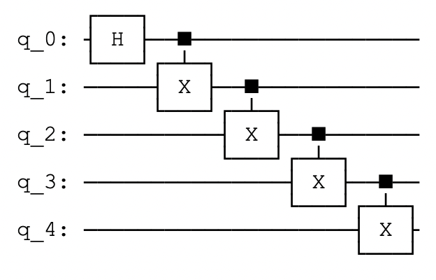
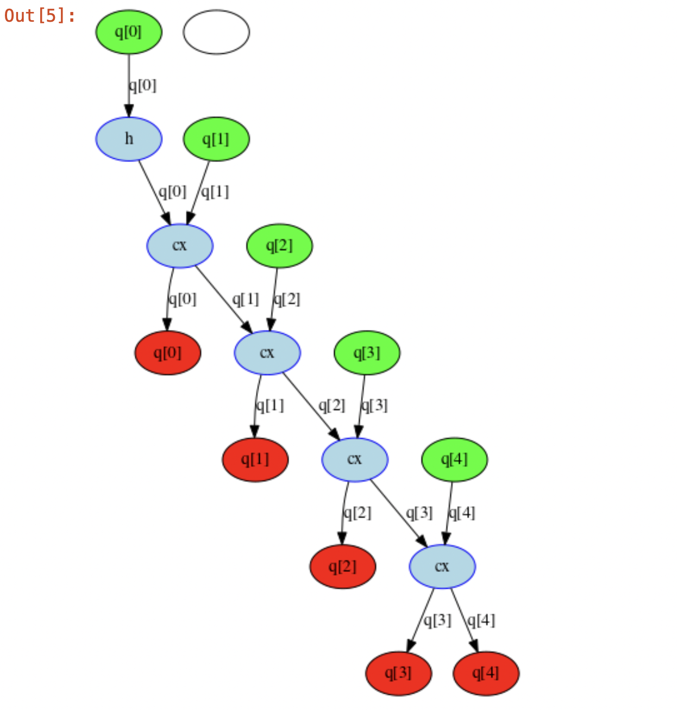
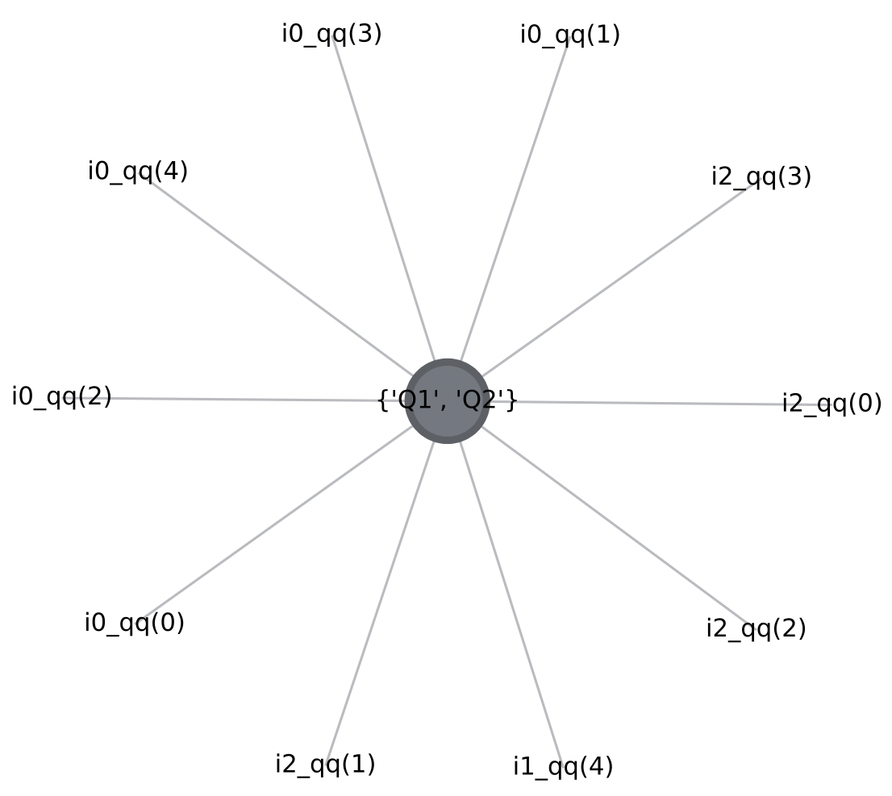

---
# Feel free to add content and custom Front Matter to this file.
# To modify the layout, see https://jekyllrb.com/docs/themes/#overriding-theme-defaults

layout: home
---

# sparse-tnqs #
Sparse Tensor Network based Quantum Simulation

*As of now, this repo hosts source code for a custom numeric library tweaked to work best for sparse tensor-network based quantum simulations. This is part of Dr. Frank's quantum computing course project: [QC-22](https://pages.github.ncsu.edu/fmuelle/qc22/ "QC-22")*

## Team ##
* Srikar Chundury (schundu3)
* Blake Burgstahler (bburgst)

## Motivation ##
* Quantum circuit simulation can be posed as a directed graph problem, where each node is a "tensor" representing the quantum gate (unitary matrix) operation on a set of input qubits. Example-  
 &nbsp;   
* The state of these input qubits evolves as the quantum circuit proceeds in time steps. With each state evolution, we are essentially performing a "contraction" (multiplication) of the input tensor (vector/matrix) with a gate tensor (X, Y, Z, CX, CCX etc) until we reach the end of the circuit.
* The order in which is contraction is performed is crucial for performance; just like how order of n matrix multiplications is crucial for performance.
* There are algorithms to get the most optimal path (like opt_einsum). Read "Algorithms for Tensor Network Contraction Ordering" under literature_survey.
* Once an optimal path is chosen, the complex quantum circuit which had multiple intermediate gates/tensors, boils down to just one big really sparse unitary matrix. Modern simulation tools like qiskit have methods to get this unitary for any given quantum circuit. As seen below- 
  

## Scope of this project ##
* We focus only on the sparsity introduced in above-mentioned simulation and create a new library that performs the "contraction" better in terms of memory, thereby reducing overall quantum simulation time.

## Problem Statement (Subject to change) ##
* Analyze intermediate unitaries for sparsity.
    * Follow the contraction path (opt_einsum) and analyze how the unitary of the circuit evolves over time steps.
* Write a custom numerical library that takes quantum sparsity patterns into account (diagonal/anti-diagonal, (1/-1/0) etc)
    * New data structure format to store sparse unitaries efficiently.
    * Handle Conversions between this new format and other formats (only NumPy as of now).
    * Implement Kernels:
        * Vector to Vector multiplication
        * Vector to Matrix multiplication
        * Matrix to Matrix multiplication
    * As a fall back, leverage NumPy for dense representations and kernels.

## Literature Survey ##
[Paper List](https://github.ncsu.edu/tnqs/sparse-tnqs/tree/main/literature_survey "Papers")

## Timeline (TBD) ##
