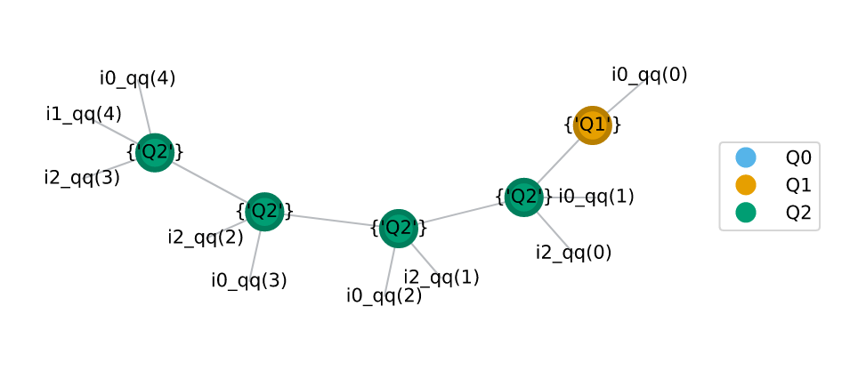
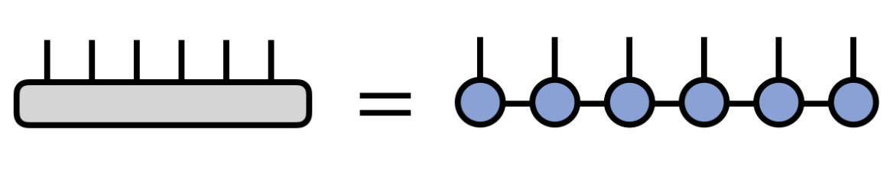
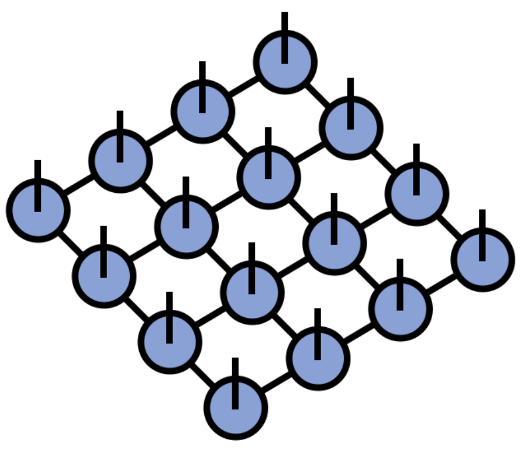

---
# Feel free to add content and custom Front Matter to this file.
# To modify the layout, see https://jekyllrb.com/docs/themes/#overriding-theme-defaults
layout: my_default
---
<head><link rel="stylesheet" href="style.css"> </head>
<!-- Side navigation -->

	

		<b> Tensor-Network based Quantum Simulation (TNQS) </b>
	

  <a href="#1">Motivation</a>
  <a href="#2">Problem Statement</a>
  <a href="#3">Empirical/Visual Analysis</a>
  <a href="#4">Key Outcomes</a>
  <a href="#5">Preliminary Results</a>
  <a href="#6">Future Scope</a>
	

	<b> Project Info </b>
	

	

	<a href="https://github.ncsu.edu/tnqs/" target="_blank"> Git Organisation (TNQS)</a>
	<a href="https://github.ncsu.edu/tnqs/sparse-tnqs/archive/refs/heads/main.zip" class="sub_link"> Download Library (zip)</a>
	

	<b> Group Info </b>
	

	<a href="https://arcb.csc.ncsu.edu/~mueller/" target="_blank" class="sub_link"> Dr. Frank Mueller</a>
	<a href="http://fruitfly1026.github.io/" target="_blank" class="sub_link"> Dr. Jiajia Li</a>
	<a href="https://www.linkedin.com/in/srikarchundury/" target="_blank" class="sub_link"> Srikar Chundury</a>
	<a href="https://www.linkedin.com/in/blake-burgstahler/" target="_blank" class="sub_link"> Blake Burgstahler</a>
	

	<b> More Info </b>
	

	<a href="https://github.ncsu.edu/tnqs/sparse-tnqs/tree/main/literature_survey" target="_blank" class="sub_link"> Literature Survey</a>
	<a href="https://github.ncsu.edu/tnqs/sparse-tnqs/tree/main/discussions" target="_blank" class="sub_link"> Reports/Discussions</a>
	

	

	<a href="https://arcb.csc.ncsu.edu/~mueller/cross.html" target="_blank"> <b> About PPoSS project </b> </a>
	

 

## Motivation ##
* Quantum circuit simulation can be posed as a directed graph problem, where each node is a "tensor" representing the quantum gate (unitary matrix) operation on a set of input qubits. Example-  

	<figure style="display: inline-block;">
		
		<figcaption>GHZ circuit from supermarQ</figcaption>
	</figure>
		&nbsp;
	<figure style="display: inline-block;">
		
		<figcaption>Qiskit-generated DAG</figcaption>
	</figure>

 

### State-Vector and Unitary Simulation ###

* The state of these input qubits evolves as the quantum circuit proceeds in time steps. With each state evolution, we are essentially performing a "contraction" (multiplication) of the input tensor (vector/matrix) with a gate tensor (X, Y, Z, CX, CCX etc) until we reach the end of the circuit.
* The order in which is contraction is performed is crucial for performance; just like how order of n matrix multiplications is crucial for performance.
* Despite its promise, simulating large quantum circuits is a daunting task due to the exponential growth of the state space. Hence there can be times when a single tensor is too huge to be stored as it is. Here is where tensor-networks come handy.

### Tensor Network Simulation ###

* Tensors, as we know, are multi-dimensional maps or functions, with a 2-dimensional tensor equivalent to a matrix. Tensor networks are modeled as graphs, with tensors as vertices and tensor methods, like contraction and decomposition, as edges. They have broad implications in various fields, including applied mathematics, chemistry, physics, and machine learning etc.
* There are algorithms to get the most optimal path (like opt_einsum). Read "Algorithms for Tensor Network Contraction Ordering" under literature_survey.
* Once an optimal path is chosen, the complex quantum circuit which had multiple intermediate gates/tensors, boils down to just one big really sparse unitary matrix. Modern simulation tools like qiskit have methods to get this unitary for any given quantum circuit. As seen below (notice the increase in dimensionality after contraction)- 
Note: In this example, the circles represent tensors in the network, for instance, the yellow circle represents the Hadamard gate and all the green ones represent CNOT gates. The lines (edges) represent bond interactions. The measurements have been removed, since this is a unitary simulation. In the notation "i{x}_qq({y})", x represents the time step and y represents the qubit that tensor acts on.

	<figure style="display: inline-block;">
		
		<figcaption>GHZ tensor network before contraction</figcaption>
	</figure>
	&nbsp;
	<figure style="display: inline-block;">
		
		<figcaption>GHZ tensor network after contraction</figcaption>
	</figure>

 

* Tensor Networks can be grouped into classes based on topology- MPS, TTN, PEPS, MERA and more.

	<figure style="display: inline-block;">
		
		<figcaption>Matrix Product State</figcaption>
	</figure>
	&nbsp;
	<figure style="display: inline-block;">
		
		<figcaption>Projected Entangled Pair State</figcaption>
	</figure>

 

* For more information related to tensor networks, refer to <a href="http://tensornetwork.org/" target="_blank"> Tensor-Networks</a>.

## Quantum Sparsity - Problem Statement ##
Explore and analyze the sparsity in the above-mentioned simulations and exploit it to reduce the overall simulation time.

Approach:
* Numerical Library: "qsparse" (placeholder name)
* Quantum Algorithm-level Library: TODO

## Preliminary Empirical Analysis (Fall '22) ##

## Key Outcomes (so far) ##

* Developed a new sparse data structure that exploits the found sparsity pattern to improve memory requirements and compute requirements for operations like contraction/decomposition. This new data structure stores all diagonals as a map, indexed by their indices, and values are contiguous arrays. The new sparse data structure allows the simulation of very wide circuits with memory demands that grow linearly (or close to) with qubits and matrix multiplication that becomes big-oh linear (or factor of it) for a small number of diagonals.
* Developed a numerical library that realizes this data structure.
* Modified the numerical library to work for higher order tensors using matricization in a way that maximizes the number of diagonals to work better for the new data structure. Implemented reshape, transpose, trace, sum for tensors, and internally efficiently stored them as matrices.
* Exposed a pip installable python interface of the C++ library using pybind11.
* Integrated the numerical library and the "sparse" library (Scipy, COO format) with opt_einsum package for testing with Quimb.
* Tested supermarQ benchmark circuits' tn-simulation using jax, numpy, tensorflow, torch, sparse, and our new library.
* Multi-threading helped reduce the time taken to format convert by ~64.9% (for 16 threads).
* To address the issue of complex arrays curtailing vectorization using SSE4.2 intrinsics, we now store two separate arrays for real and imaginary numbers within the new data structure. This improved the matrix multiplication performance by ~13.7% (for 26 qubit GHZ simulation).

## Preliminary Results (Spring '23) ##

## Future Plans (Fall '23) ##

* Move away from SSE and towards AVX.
* Compare the library's implementation with state-of-the-art dense kernels like that of open BLAS 3's cGEMM implementation.
* Explore better utilization of cache through techniques like blocking. It is anticipated that utilizing the library will enable simulation of very large qubit circuits (>20) that cause other libraries like numpy to run out of memory.
* Develop a quantum algorithm level library like Koala/Qiskit/Quimb that is tailored to our numerical library and stores gates in our library's format would eliminate the need for any format conversions and is expected to result in the greatest performance gains.
* Explore the possibility of identifying sub-circuits that can be efficiently simulated using the data structure through techniques like memoization.

## Progress Update 1 ##
* Analyzed sparsity of quantum circuits represented as unitaries.    
    * Obtained final unitaries using quimb, qiskit (unitary simulator) for quantum circuit benchmarks described in the supermarQ paper (refer literature survey below). Some results (for 3 qubit benchmark circuits) look like this-
        * GHZ circuit    &nbsp;   
        * Hamiltonian circuit    &nbsp;   
        * Mermin Bell circuit    &nbsp;   
    
    * Some observations:
        * Final unitaries can be compactly represented using just the diagonals and anti-diagonals.
        * Final unitaries' range of values is limited and can easily be written as constant times a matrix with just +1,0,-1 paving scope for reducing #flops in contraction kernels.
    
    * Claim (yet to prove): The intermediate matrices in the contration path have similar sparsity patterns. Support for this claim: the same benchmark ciruits when run for smaller/higher number of qubits result in unitaries looking very similar.

* New sparse data structure-
    * A quantum sparse matrix (QSM) is a collection of "diagonals" stored as a hashmap, with each diagonal's index as the key (0 for main diagonal, 1 for super diagonal, -1 for sub diagonal and so on.)
    * Each diagonal is represented using 2 arrays (one for indices and one for the actual values) that store only non-zero values; diagonal is also sparse.
    * Each value is a complex number

* Kernel algorithms and their complexities-
    * Any square matrix of size n has 2n-1 principal diagonals.
    * Any square matrix can be written as a sum of 2n-1 matrices (each matrix with just one diagonal).
    * Matrix-Matrix (A.B) multiplication algorithm: can be divided into subproblems like so-
        * (A-n + ... + A0 + A1 + ... + An) . (B-n + ... + B0 + B1 + ... + Bn)
        * A-n . (B-n + ... + B0 + B1 + ... + Bn) + A-(n-1) . (B-n + ... + B0 + B1 + ... + Bn) + ...
        * A-n . B-n + A-n . (B-(n-1) + ... + ...  [ (2n-1) (2n-1) terms, 2n-1 is the number of diagonals ]
        * Each of the above multiplication takes linear time and is independent of any other term in the summation and hence is parallelizable.
        * So, overall time complexity would be of the order O(n\*d\*d) where n is the length of each diagonal, d is the number of diagonals.
        * In quantum simulations, as we've seen from the analysis, the number of diagonals is far smaller than the size of the matrix (for example, the vqe prep for 4 qubits results in a 16x16 matrix, but with elements only on 4 anti-diagonals). Hence, we claim that this approach significantly improves the multiplication operation (a.k.a the contraction step).

## Progress Update 2 ##
* Jotted down M-M algorithms for 2 variations of diagonal matrix formats- Sparse Diagonal and Compressed Sparse Diagonal.
    * Sparse Diagonal: Diagonals are represented using their index (gives us the position) and their a vector of their values. (half leveraging quantum sparsity)
    * Compressed Sparse Diagonal: The sparsity within diagonals is leveraged to store the vectors in a compressed fashion (like with CSR). So, a digonal here has an index, an array that stores non-zero indices within the diagonal and another array that stores the actual complex values.
* In both versions, matrices are a map of diagonal indices to respective diagonal objects.
* We implemented the "Sparse Diagonal" format using c++11.
    * Tested using supermarq (refer literature survey) benchmark circuits and counter the number of #flops for different cases. We ran for different sizes of these circuits from 3 to 11. In the future, we plan to also run for >18 qubits on the ARC cluster.
    * GHZ circuit     
    * Hamiltonian circuit     
    * Mermin Bell circuit     

## QAOA Max-Cut ##

Consider the below circuit that uses QAOA to find max-cut of a square, after stripping off measurements and Hadamards) ([Qiskit Ref](https://qiskit.org/textbook/ch-applications/qaoa.html))
  

This is how the intermediate unitaries look like-  
  

Dense(numPy) vs Diagonal(our approach comparison)-   
  

 

