---
# Feel free to add content and custom Front Matter to this file.
# To modify the layout, see https://jekyllrb.com/docs/themes/#overriding-theme-defaults
layout: home
---
<head><link rel="stylesheet" href="style.css"> </head>
<!-- Side navigation -->

	

		<b> Tensor-Network based Quantum Simulation (TNQS) </b>
	

  <a href="#1">Motivation</a>
  <a href="#2">Scope of this project</a>
  <a href="#3">Problem Statement</a>
  <a href="#4">Progress - update #1</a>
  <a href="#7">Progress - update #2</a>
  <a href="#8">QAOA - Max Cut</a>
  <a href="#5">Literature Survey</a>
  <a href="#6">Note</a>
	

	<b> Project Info </b>
	

	

	<a href="https://github.ncsu.edu/tnqs/sparse-tnqs/" target="_blank"> Git Organisation (TNQS)</a>
	<a href="https://github.ncsu.edu/tnqs/sparse-tnqs/tree/main/discussions" target="_blank" class="sub_link"> All Reports (requires NCSU creds)</a>
	<a href="https://github.ncsu.edu/tnqs/sparse-tnqs/archive/refs/heads/main.zip" class="sub_link"> Download Library (zip)</a>
	

	<b> Group Info </b>
	

	<a href="https://arcb.csc.ncsu.edu/~mueller/" target="_blank" class="sub_link"> Dr. Frank Mueller</a>
	<a href="http://fruitfly1026.github.io/" target="_blank" class="sub_link"> Dr. Jiajia Li</a>
	<a href="https://www.linkedin.com/in/srikarchundury/" target="_blank" class="sub_link"> Srikar Chundury</a>
	<a href="https://www.linkedin.com/in/blake-burgstahler/" target="_blank" class="sub_link"> Blake Burgstahler</a>
		

		<a href="https://arcb.csc.ncsu.edu/~mueller/cross.html" target="_blank"> <b> More Info </b> </a>
		

	

 

## Motivation ##
* Quantum circuit simulation can be posed as a directed graph problem, where each node is a "tensor" representing the quantum gate (unitary matrix) operation on a set of input qubits. Example-  

	<figure style="display: inline-block;">
		
		<figcaption>GHZ circuit from supermarQ</figcaption>
	</figure>
		&nbsp;
	<figure style="display: inline-block;">
		
		<figcaption>Qiskit-generated DAG</figcaption>
	</figure>

 
* The state of these input qubits evolves as the quantum circuit proceeds in time steps. With each state evolution, we are essentially performing a "contraction" (multiplication) of the input tensor (vector/matrix) with a gate tensor (X, Y, Z, CX, CCX etc) until we reach the end of the circuit.
* The order in which is contraction is performed is crucial for performance; just like how order of n matrix multiplications is crucial for performance.
* There are algorithms to get the most optimal path (like opt_einsum). Read "Algorithms for Tensor Network Contraction Ordering" under literature_survey.
* Once an optimal path is chosen, the complex quantum circuit which had multiple intermediate gates/tensors, boils down to just one big really sparse unitary matrix. Modern simulation tools like qiskit have methods to get this unitary for any given quantum circuit. As seen below- 

	<figure style="display: inline-block;">
		
		<figcaption>GHZ tensor network after contraction</figcaption>
	</figure>

 

## Scope of this project ##
* We focus only on the sparsity introduced in above-mentioned simulation and create a new library that performs the "contraction" better in terms of memory, thereby reducing overall quantum simulation time.

## Problem Statement ##
* Analyze intermediate unitaries for sparsity. [&check;]
    * Follow the contraction path (opt_einsum) and analyze how the unitary of the circuit evolves over time steps.
* New data structure format to store sparse unitaries efficiently.[&check;]
    * Make use of diagonals and anti-diagonals. 
    * Estimate the time and space complexities for kernel algorithmics involved (Matrix-Vector, Matrix-Matrix).
* Implement the new data structure and kernels in c++ and expose as a custom library. [In-progress]
    * Handle Conversions between this new format and numPy.
    * Kernels:
        * Vector to Vector multiplication [delayed, removed from scope of qc-22 course project]
        * Vector to Matrix multiplication [delayed, removed from scope of qc-22 course project]
        * Matrix to Matrix multiplication - (used in contraction in tensor-network based simulations). [&check;]
    * Compare performance using metrics- #flops, memory (kB) and #intops (number of floats/doubles that can be represented with just integers). [In-progess, compared #flops algorithmically]

## Progress Update 1 ##
* Analyzed sparsity of quantum circuits represented as unitaries.    
    * Obtained final unitaries using quimb, qiskit (unitary simulator) for quantum circuit benchmarks described in the supermarQ paper (refer literature survey below). Some results (for 3 qubit benchmark circuits) look like this-
        * GHZ circuit   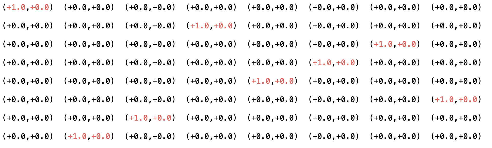 &nbsp; 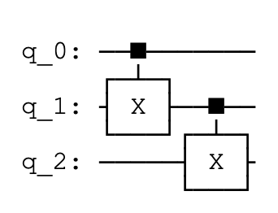  
        * Hamiltonian circuit   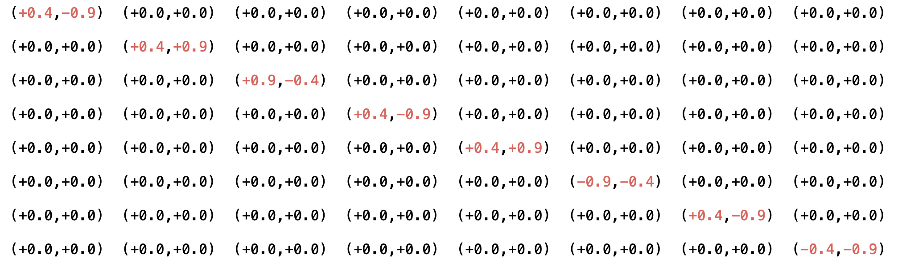 &nbsp; 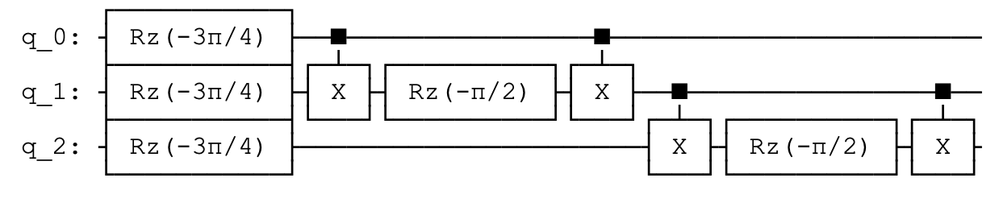  
        * Mermin Bell circuit   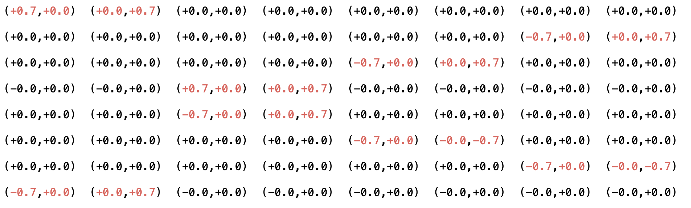 &nbsp; 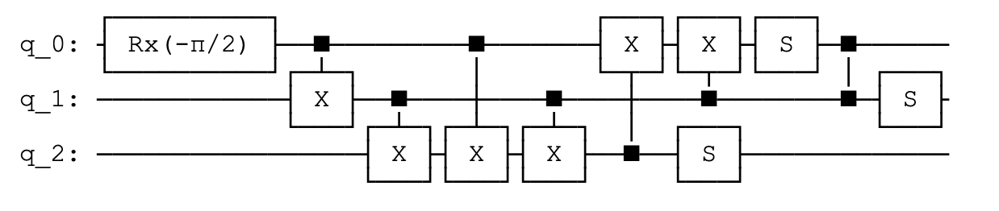  
    
    * Some observations:
        * Final unitaries can be compactly represented using just the diagonals and anti-diagonals.
        * Final unitaries' range of values is limited and can easily be written as constant times a matrix with just +1,0,-1 paving scope for reducing #flops in contraction kernels.
    
    * Claim (yet to prove): The intermediate matrices in the contration path have similar sparsity patterns. Support for this claim: the same benchmark ciruits when run for smaller/higher number of qubits result in unitaries looking very similar.

* New sparse data structure-
    * A quantum sparse matrix (QSM) is a collection of "diagonals" stored as a hashmap, with each diagonal's index as the key (0 for main diagonal, 1 for super diagonal, -1 for sub diagonal and so on.)
    * Each diagonal is represented using 2 arrays (one for indices and one for the actual values) that store only non-zero values; diagonal is also sparse.
    * Each value is a complex number

* Kernel algorithms and their complexities-
    * Any square matrix of size n has 2n-1 principal diagonals.
    * Any square matrix can be written as a sum of 2n-1 matrices (each matrix with just one diagonal).
    * Matrix-Matrix (A.B) multiplication algorithm: can be divided into subproblems like so-
        * (A-n + ... + A0 + A1 + ... + An) . (B-n + ... + B0 + B1 + ... + Bn)
        * A-n . (B-n + ... + B0 + B1 + ... + Bn) + A-(n-1) . (B-n + ... + B0 + B1 + ... + Bn) + ...
        * A-n . B-n + A-n . (B-(n-1) + ... + ...  [ (2n-1) (2n-1) terms, 2n-1 is the number of diagonals ]
        * Each of the above multiplication takes linear time and is independent of any other term in the summation and hence is parallelizable.
        * So, overall time complexity would be of the order O(n\*d\*d) where n is the length of each diagonal, d is the number of diagonals.
        * In quantum simulations, as we've seen from the analysis, the number of diagonals is far smaller than the size of the matrix (for example, the vqe prep for 4 qubits results in a 16x16 matrix, but with elements only on 4 anti-diagonals). Hence, we claim that this approach significantly improves the multiplication operation (a.k.a the contraction step).

## Progress Update 2 ##
* Jotted down M-M algorithms for 2 variations of diagonal matrix formats- Sparse Diagonal and Compressed Sparse Diagonal.
    * Sparse Diagonal: Diagonals are represented using their index (gives us the position) and their a vector of their values. (half leveraging quantum sparsity)
    * Compressed Sparse Diagonal: The sparsity within diagonals is leveraged to store the vectors in a compressed fashion (like with CSR). So, a digonal here has an index, an array that stores non-zero indices within the diagonal and another array that stores the actual complex values.
* In both versions, matrices are a map of diagonal indices to respective diagonal objects.
* We implemented the "Sparse Diagonal" format using c++11.
    * Tested using supermarq (refer literature survey) benchmark circuits and counter the number of #flops for different cases. We ran for different sizes of these circuits from 3 to 11. In the future, we plan to also run for >18 qubits on the ARC cluster.
    * GHZ circuit   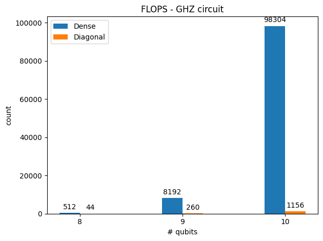  
    * Hamiltonian circuit   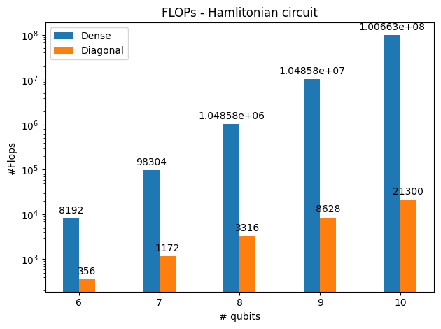  
    * Mermin Bell circuit   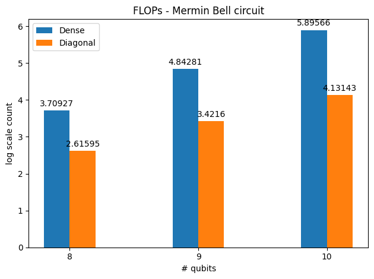  

## QAOA Max-Cut ##

Consider the below circuit that uses QAOA to find max-cut of a square, after stripping off measurements and Hadamards) ([Qiskit Ref](https://qiskit.org/textbook/ch-applications/qaoa.html))
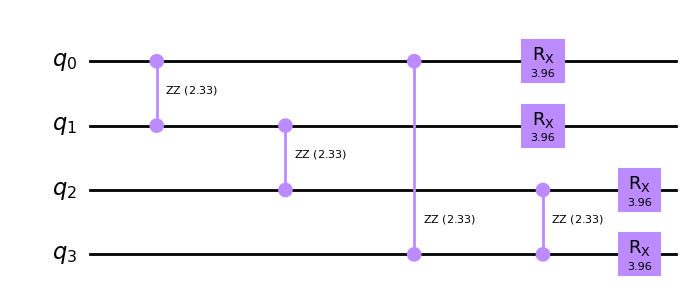  

This is how the intermediate unitaries look like-  
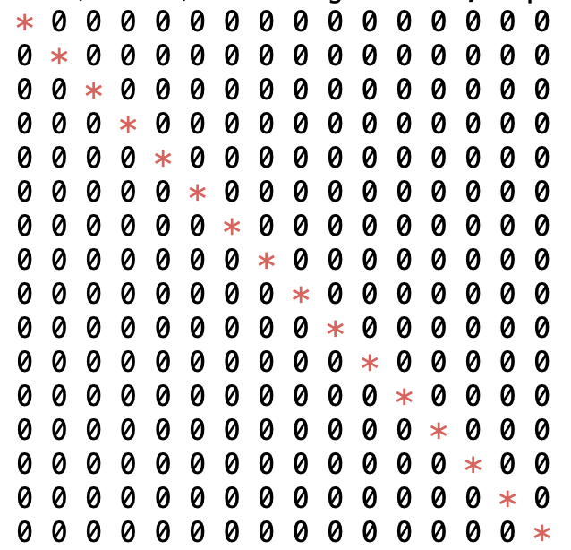  

Dense(numPy) vs Diagonal(our approach comparison)-   
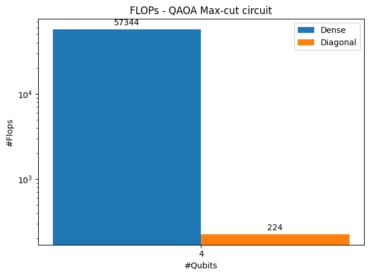  

## Literature Survey ##
[Paper List](https://github.ncsu.edu/tnqs/sparse-tnqs/tree/main/literature_survey "Papers")

## Note ##
* Please refer [Reports/Discussion](https://github.ncsu.edu/tnqs/sparse-tnqs/tree/main/discussions "Discussion") for timeline and progress so far.

 

